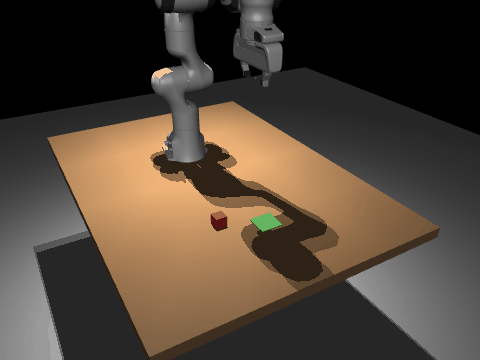
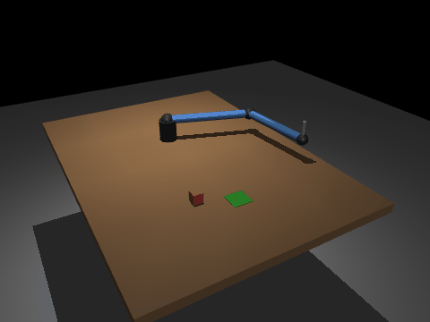
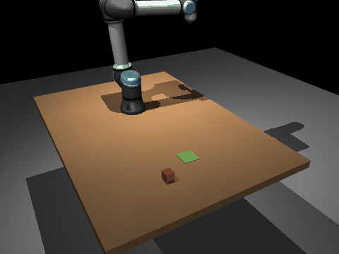
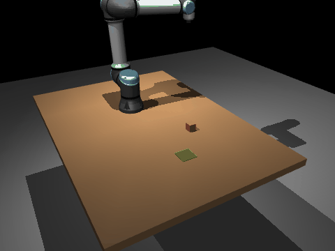
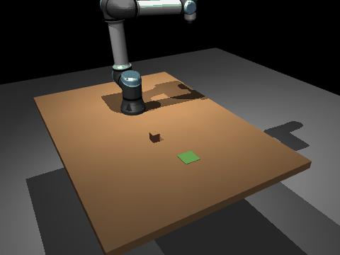
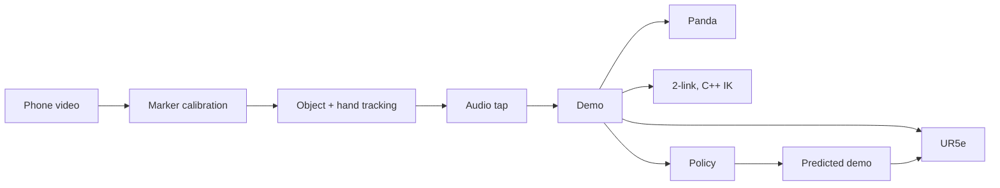
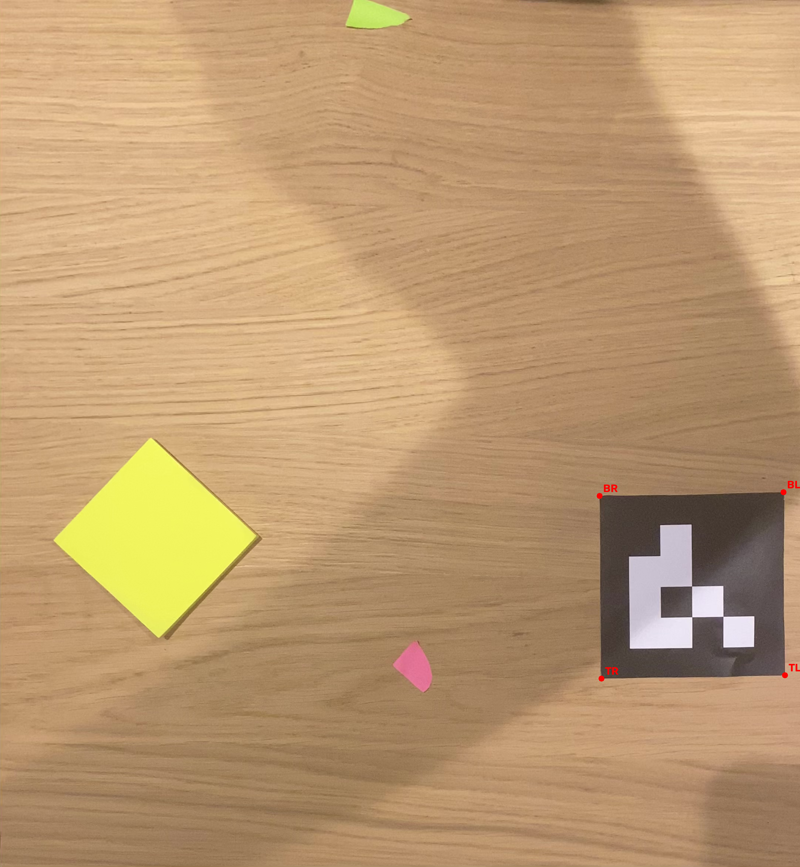
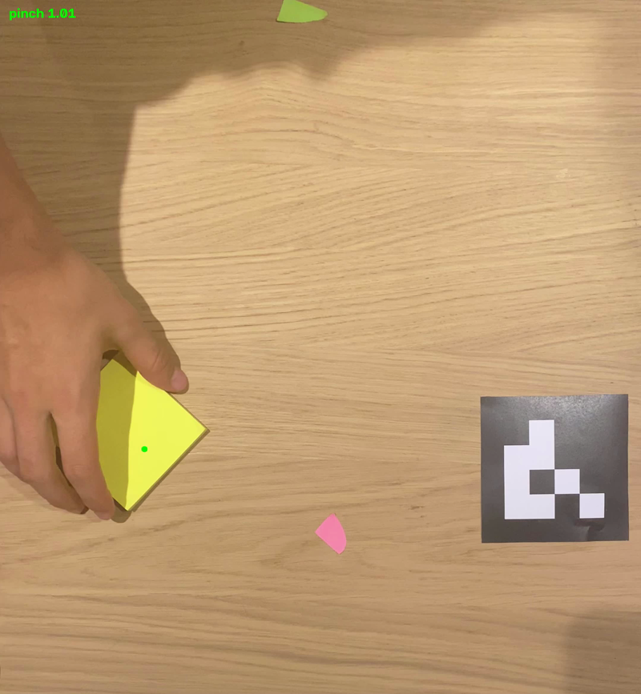

# phone-to-robot-arm

Film yourself moving an object with your phone. Three different robots do the same in simulation. One phone demo is turned into table coordinates, replayed on a Franka Panda, a UR5e and a 2-link arm I designed, then used to train a small policy. The 2-link arm runs on my [2D Inverse Kinematics Solver](https://github.com/curtislight/2D-Inverse-Kinematic-Solver), and is the simulated counterpart to my [2D Arm Joint Control](https://github.com/curtislight/2D-Arm-Joint-Control) project.

Built for Humanoid's Robot Learning intern challenge, October 2026.

| Panda | UR5e | 2-link (my C++ IK) |
|---|---|---|
|  |  |  |

_The same phone demo, replayed on three different robots._

| Far right | Near left | Near centre |
|---|---|---|
|  |  |  |

_Different starting positions, all on the UR5e._

## Approach

- **Calibration**: a printed ArUco marker of known size and position maps every pixel to a table position in metres.
- **Demo extraction**: the object's position before my hand enters and after it leaves gives exact grab and release points. MediaPipe tracks my hand for the path and the timing.
- **Audio**: the tap of the object landing pins down the release moment.
- **Retargeting**: each demo replays on three robots. The Panda and UR5e use mink for IK, the 2-link arm uses my C++ library through pybind11.
- **Policy**: a regularised linear model learns the path and release from the start position, tested on held-out demos against a baseline.



| Calibration | Hand tracking |
|---|---|
|  |  |

_Left: detected marker corners. Right: grasp point between thumb and index._

## Results

13 demos on all three robots. Success means the object's centre lands within 4cm of the target's.

| Robot | Success | Error to target | Error to my release |
|---|---|---|---|
| Panda | 12 / 13 | 20.4 mm | 7.8 mm |
| UR5e | 10 / 13 | 24.2 mm | 2.8 mm |
| 2-link | 11 / 13 | 29.0 mm | 27.8 mm |

The last column measures how faithfully each robot copies my hand. Most "failures" are mine: my own release was just over 4cm off target, and the robot copied it. The 2-link arm drags the object rather than lifting it, so it's the loosest.

**Policy on 3 held-out demos**

| | Release error | Path error |
|---|---|---|
| Linear policy | 21.0 mm | 54.0 mm |
| Baseline | 16.0 mm | 54.3 mm |
| Neural net (first try) | 36.8 mm | 132.7 mm |

The neural net memorised the 10 training demos and lost badly. The linear model predicts corrections on top of the baseline, so with little data it can't memorise and falls back to the baseline. It beats the baseline on path for demos 09 and 13, inside the training spread, and loses on 04, at the edge. On release the baseline wins: my target never moves.

Fed only the start position, the policy's predictions ran on the UR5e: **3 out of 3 successes**, runs no human performed.


## Parameters

| Parameter | Value | | Parameter | Value |
|---|---|---|---|---|
| Marker size | 0.10 m | | Demos | 13 (10 train, 3 test) |
| Virtual robot base | 25 cm behind tape mark | | Held-out | 04, 09, 13 |
| Success radius | 4 cm | | Path points | 10 |
| 2-link links | 0.40, 0.35 m | | Policy | Linear, weight penalty 0.1 |
| 2-link slide | 6 cm | | Suction force | 10 N |

## Project structure

| File | Responsibility |
|---|---|
| `src/calibrate.py` | Marker detection, pixels to table metres |
| `src/hand_track.py` | Video to demo: object and hand tracking |
| `src/audio.py` | Release timing from the tap |
| `src/ik.py` | Robot selection, IK with mink |
| `src/pick.py` | Pick and place sequence, one for all three robots |
| `src/retarget.py` | Demo onto any robot, scored, optional GIF |
| `src/policy.py` | Train and test the policy |
| `cpp/` | My IK library (submodule) and pybind11 bindings |
| `assets/` | Panda, UR5e and 2-link scenes |
| `demos/`, `results/` | Extracted demos and scores |

## Running it

Python 3.12, tested on macOS.

```
git clone --recurse-submodules https://github.com/curtislight/phone-to-robot-arm.git
cd phone-to-robot-arm
python3.12 -m venv .venv && source .venv/bin/activate
pip install -r requirements.txt
mkdir -p models && curl -L -o models/hand_landmarker.task https://storage.googleapis.com/mediapipe-models/hand_landmarker/hand_landmarker/float16/latest/hand_landmarker.task
c++ -O3 -shared -std=c++17 -undefined dynamic_lookup $(python -m pybind11 --includes) cpp/bindings.cpp cpp/ik_solver/solver.cpp cpp/ik_solver/vec2.cpp -o src/ik2d$(python -c "import sysconfig; print(sysconfig.get_config_var('EXT_SUFFIX'))")
```

Videos aren't included. Extracted demos are in `demos/`, so start from step 3.

1. `python src/hand_track.py videos/*.mov` turns videos into demos.
2. `python src/audio.py videos/*.mov` refines the releases.
3. `mjpython src/retarget.py demos/demo_01.json` replays one. Pick 1 Panda, 2 UR5e, 3 2-link.
4. `python src/policy.py train` then `python src/policy.py test`.

## Design notes

- **Object, not fingers, marks grab and release.** Holding an object keeps thumb and index apart, so the finger gap flickered mid-carry. The object's own start and end positions are exact.
- **Colour, not brightness, finds the marker.** Glare washed the printed black out to the same brightness as the wood, so 12 of 13 videos failed. The table is coloured and the marker isn't, so coloured pixels are whitened before detection.
- **Virtual robot moved 25cm back.** Most demos started too close for the Panda to reach down. Panda went from 4 to 12 successes out of 13.
- **Suction on the UR5e and 2-link arm**, via MuJoCo's adhesion actuator. Menagerie's UR5e has no gripper.
- **One sequence, three robots.** Each robot brings its own `go` function and gripper values. Link lengths are read from the XML.
- **Angle conventions.** My library uses degrees from vertical and the elbow's inside angle. MuJoCo wants radians from x and the bend from straight.
- **pybind11 on macOS 27.** The linker didn't understand the newest SDK. Prefix the build with `SDKROOT=/Library/Developer/CommandLineTools/SDKs/MacOSX26.sdk`.

## Assumptions and known issues

- **The real object was a flat sticky note** standing in for the 4cm sim cube. It's quiet, so audio missed the tap on 3 of 13 demos.
- **No height from overhead.** Fingertips sit above the table, so the hand path carries a small parallax error.
- **The 2-link tool drags the object** instead of lifting it cleanly.
- **13 demos is small.** The policy is a proof of concept.

## Roadmap

- [x] MuJoCo scenes for Panda, UR5e and a custom 2-link arm
- [x] IK with mink, and my C++ IK through pybind11
- [x] Marker calibration, object and hand tracking, audio release timing
- [x] Replay on all three robots, scored
- [x] Policy with baselines, driving a robot on held-out demos
- [ ] Fix the 2-link drag with a smaller cup and longer slide
- [ ] More demos, a real cube, and a moving target so release prediction matters
- [ ] Use the 2D Arm Joint Control PID loops for the 2-link joints

## Built with

MuJoCo · [Menagerie](https://github.com/google-deepmind/mujoco_menagerie) (Apache 2.0, grip sites and suction cup added) · [mink](https://github.com/kevinzakka/mink) · MediaPipe · OpenCV · librosa · PyTorch · pybind11 · C++

All demo data is from my own recordings.